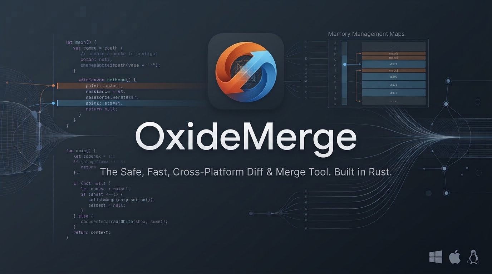
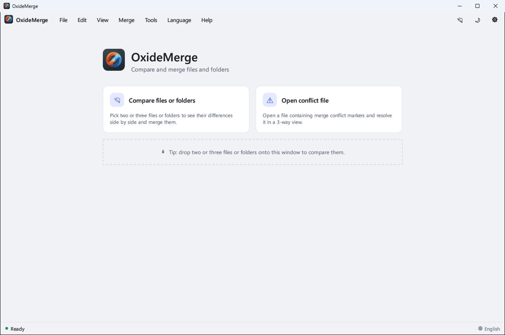
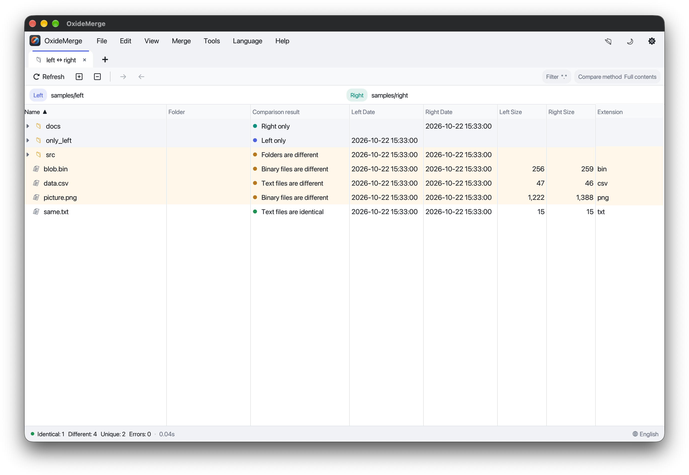
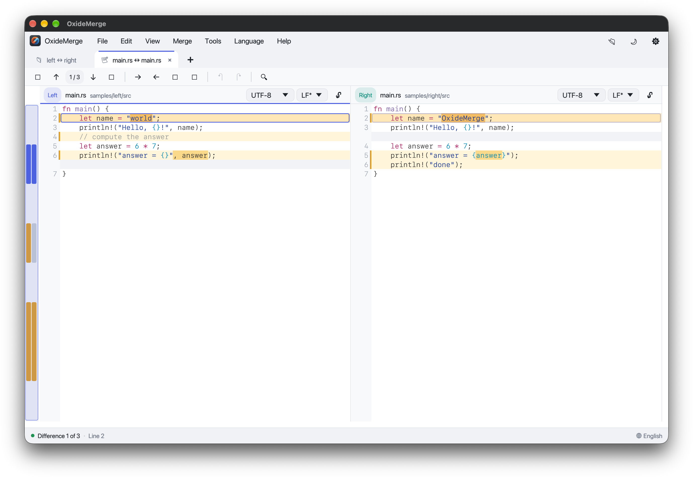

# OxideMerge



OxideMerge is an open source, cross-platform differencing and merging tool written in Rust. It
brings the feature set of [WinMerge](https://winmerge.org/)
([source](https://github.com/WinMerge/winmerge)) to **Windows, macOS and Linux**. It compares and
merges folders, text files, binary files and images, and compares web pages, with a modern
multilingual UI.

The name comes from the language it is written in: rust is iron oxide.



| Folder compare | Text compare |
| --- | --- |
|  |  |

## Features

**Folder compare and merge**
- 2-way and 3-way folder comparison, recursive or flat, shown as a tree or a flat list.
- Compare methods: full contents, quick contents, binary contents, modified date, date and size, size only.
- Show or hide identical, different and unique items. Copy items between sides or delete them,
  with optional Recycle Bin support and confirmation prompts.
- Keyboard selection: arrow keys, Page Up/Down, Home/End, Shift to extend, Ctrl+A to select all.
- File filters: wildcard masks such as `*.c;*.h;!*.bak;!.git\` and WinMerge `.flt` filter files.
- Zip-based archives (`.zip`, `.jar`, `.apk`, `.docx`, `.xlsx`, `.odt`, `.epub`, `.nupkg`, ...) are extracted and compared as folders.
- Reports in HTML, CSV and plain text.

**Text compare and merge**
- 2-way and 3-way comparison with Myers, Patience or LCS diff algorithms.
- Inline (word and character) differences, moved-block detection and a location pane overview.
- WinMerge-style ignore options: whitespace (changes or all), case, blank lines, end-of-line style,
  numbers and code page.
- Copy differences left or right, copy all, auto merge for 3-way compares, undo and redo, and in-place editing.
- Resolve version-control conflict files containing `<<<<<<<`, `|||||||`, `=======` and `>>>>>>>` markers.
- Encoding and end-of-line detection, syntax highlighting, find, go to line, and CSV/TSV table mode.
- Patch generation in normal, context and unified formats.
- Files changed by another program are detected when the window regains focus: unmodified files
  reload automatically, and files with unsaved edits show a bar offering to reload them.
- Unpacker plugins: run an external command (for example `pandoc -t plain ${file}`) to convert files to text before comparing.

**Binary compare**
- Side-by-side hex view with byte-level differences, navigation and synchronized scrolling.

**Image compare**
- Side-by-side, overlay and difference modes, with zoom, fit and 1:1 views.
- Difference blocks highlighted with an adjustable color threshold and block size.

**Web page compare**
- Compare two or three `http://`, `https://` URLs or local HTML files, in four modes:
  - **Screenshot**: renders each page with a headless Chromium-based browser (Edge, Chrome,
    Chromium or Brave, found automatically) and opens the images in the image compare.
  - **HTML source**: the page source, with long minified lines split between tags, in the text compare.
  - **Text**: the visible text of each page (scripts, styles and markup removed), in the text compare.
  - **Resource tree**: downloads each page with its stylesheets, scripts, images, frames and media,
    and compares the downloaded files in the folder compare.
- Pages are decoded using the HTTP or `<meta>` charset. Non-2xx HTTP status codes are shown in the pane header.

**Interface**
- Tabbed documents, a start page with recent comparisons, and drag and drop of files and folders.
- Light and dark themes.
- 10 built-in languages: English, 繁體中文, 简体中文, 日本語, 한국어, Deutsch, Français, Español,
  Русский and Português (Brasil). You can add more as JSON files (see [Languages](#languages)).
- Windows Explorer context menu integration (Windows only).

## Platforms

| Platform | Notes |
| --- | --- |
| Windows 10/11 | Explorer context menu, WinMerge-style `/switch` arguments, Recycle Bin |
| macOS 11+ | Native file dialogs, Trash, "Reveal in Finder" |
| Linux (X11 and Wayland) | File dialogs through the XDG desktop portal, freedesktop Trash |

The same code base builds on all three. Fonts come from the system: Segoe UI and Cascadia Mono on
Windows, SF and Menlo on macOS, and Noto, Inter or DejaVu on Linux. For Chinese, Japanese and
Korean text on Linux, any CJK font that fontconfig knows about is used (Noto Sans CJK or WenQuanYi
recommended); under WSL the Windows fonts are used when no Linux CJK font is installed.

Under WSL2 the app selects Mesa's `d3d12` driver (GPU acceleration through WSLg) when it is
installed and silences Mesa's EGL driver-probing warnings. Set `GALLIUM_DRIVER` or `EGL_LOG_LEVEL`
yourself to override either.

## Installing

Every [GitHub release](https://github.com/kuopinghsu/OxideMerge/releases) has these packages, and
`SHA256SUMS.txt` to check them against:

| Platform | Package |
| --- | --- |
| Windows x64 | `oxidemerge-<version>-windows-x64.exe` (runs as is) or `.zip` |
| Linux x64 | `.AppImage` (Ubuntu 20.04, RHEL 8, Debian 10 and newer; no install needed), `.deb` (Ubuntu 22.04 and newer), or `.tar.gz` |
| macOS 11+ (Apple silicon and Intel) | `oxidemerge-<version>-macos-universal.dmg`, or the same app in a `.zip` |

- **Linux:** run `chmod +x oxidemerge-*.AppImage` before starting the AppImage. Without FUSE, start
  it with `--appimage-extract-and-run`. To install the Debian package, run
  `sudo apt install ./oxidemerge-*.deb`. File dialogs need `xdg-desktop-portal`, which desktop
  environments normally include.
- **macOS:** the app is ad-hoc signed but not notarized. The first time, Control-click it and choose
  **Open**, or allow it in **System Settings → Privacy & Security**. To use it from the terminal, run
  `sudo ln -s /Applications/OxideMerge.app/Contents/MacOS/oxidemerge /usr/local/bin/oxidemerge`.

## Building

You need a Rust toolchain ([rustup](https://rustup.rs/)). On Linux, a C compiler is also needed.
OxideMerge loads the X11, Wayland, keyboard and OpenGL libraries at runtime, so it needs no
development packages to build.

Then build:

```sh
cargo build --release          # binary: target/release/oxidemerge(.exe)
cargo test
```

### Make targets

A `Makefile` for GNU Make wraps the common tasks. It works on Windows and Unix.

| Target | Description |
| --- | --- |
| `make` / `make release` | Optimized release build |
| `make build` | Debug build |
| `make run ARGS="a.txt b.txt"` | Run the debug build with arguments |
| `make demo` | Folder compare of `samples/left` and `samples/right` |
| `make demo-text` / `demo-3way` / `demo-conflict` | Text, 3-way and conflict-file demos |
| `make test` / `check` / `lint` | Unit tests, type check, clippy with warnings as errors |
| `make ci` | `check`, `lint` and `test` |
| `make check-platforms` | Type-check for Windows, macOS and Linux (needs `rustup target add` for each) |
| `make install` / `uninstall` | `cargo install` into `~/.cargo/bin` |
| `make shell-register` | Install, then add the Explorer context menu (Windows) |
| `make dist` | Package the release binary into `dist/` (`.zip` on Windows, `.tar.gz` elsewhere) |
| `make clean` | Remove build output |
| `make help` | List all targets |

### Continuous integration

[`.github/workflows/ci.yml`](.github/workflows/ci.yml) runs on every push to `main` and on every
pull request. On Windows, Linux and macOS it runs clippy with warnings treated as errors, runs the
unit tests, builds a release, and smoke-tests the command line (`--version`, `--list-languages` and
the `--cli` exit codes). It then uploads these packages as workflow artifacts:

- **Windows:** the `.exe` and a `.zip`.
- **Linux:** a `.tar.gz` and a `.deb`, built on Ubuntu 22.04.
- **Linux AppImage:** built on AlmaLinux 8 (glibc 2.28). It bundles the X11, Wayland and keyboard
  libraries, and [`assets/AppRun`](assets/AppRun) uses them only when the system lacks them. The
  AppImage is then checked on Ubuntu 22.04 and 24.04 and on AlmaLinux 8 and 9: every bundled
  library must resolve, the command line must work, and the window must stay open under Xvfb.
- **macOS:** a universal (Apple silicon and Intel) `OxideMerge.app`, ad-hoc signed, in a `.dmg` and
  a `.zip`.

Pushing a tag such as `v0.9.1` publishes all packages and `SHA256SUMS.txt` on a GitHub release. The
tag must match the version in `Cargo.toml`, and tags containing `-` (for example `v1.0.0-rc1`) are
marked as pre-releases.

## Usage

Start `oxidemerge` without arguments to open the start page. From there you can open files or
folders, drag them onto the window, or pick a recent comparison.

```sh
oxidemerge left.txt right.txt                   # 2-way text compare
oxidemerge mine.txt base.txt theirs.txt         # 3-way compare (middle = base)
oxidemerge -r C:\project\v1 C:\project\v2       # recursive folder compare
oxidemerge -r -f "*.rs;!target/" old new        # folder compare with a filter
oxidemerge conflict.txt                         # resolve a file with conflict markers
oxidemerge -t image a.png b.png                 # force the compare type
oxidemerge https://example.com https://example.org   # web page compare
oxidemerge -t web old.html new.html             # compare local HTML files as web pages
oxidemerge left.txt right.txt -o merged.txt     # save the merge result to another file
```

A web page compare tab has a mode bar (Screenshot, HTML source, Text, Resource tree) and a reload
button. The last mode used is remembered. Screenshot size and the browser path are set under
**Options → Image / Binary / Web**. Leave the browser path empty to detect it automatically.

### Command line options

| Option | Description |
| --- | --- |
| `PATHS...` | 2 or 3 files, folders or URLs, or a single conflict file |
| `-r, --recursive` | Include subfolders in folder compares |
| `-f, --filter <MASK>` | File filter, for example `*.c;*.h` or `!*.bak` |
| `-m, --method <M>` | Folder compare method: `full`, `quick`, `binary`, `date`, `datesize`, `size` |
| `-t, --compare-as <T>` | Force `text`, `binary`, `image` or `web` |
| `-o, --output <PATH>` | Output path for the merge result |
| `--dl/--dm/--dr <TEXT>` | Descriptions shown instead of the left, middle and right paths |
| `--wl/--wm/--wr` | Open the left, middle or right side read-only |
| `--ignore-ws <MODE>` | Ignore whitespace: `compare`, `change` or `all` |
| `--ignore-case`, `--ignore-blank`, `--ignore-eol`, `--ignore-numbers` | Ignore options |
| `--report <FILE>` | Write a folder compare report (`.html`, `.csv` or `.txt`) |
| `--patch <FILE>` | Write a patch for two files or folders |
| `--patch-style <S>` | `normal`, `context` or `unified` (default) |
| `--context <N>` | Context lines for patches (default 3) |
| `--cli` | Run without a window; exit code 0 = identical, 1 = different, 2 = error |
| `--lang <CODE>` | UI language, for example `ja` or `zh-TW` |
| `--list-languages` | Print the available languages |
| `--register-shell` / `--unregister-shell` | Add or remove the Explorer context menu (Windows) |

On Windows, WinMerge-style switches are also accepted, so existing scripts keep working:
`/r`, `/f`, `/o`, `/dl`, `/dr`, `/wl`, `/wr` and so on.

### Scripting

```sh
# Exit code only, no window
oxidemerge --cli -r dirA dirB && echo identical

# HTML report of a folder compare (--report and --patch never open a window)
oxidemerge -r dirA dirB --report report.html

# Unified diff with 5 lines of context
oxidemerge old.c new.c --patch changes.patch --context 5

# Compare the visible text of two web pages (the HTML source when the last mode was HTML source)
oxidemerge --cli https://staging.example.com/ https://www.example.com/
```

### Keyboard shortcuts

Press `F1` or `?`, or click the `?` button at the top right, to open the Help & Shortcuts
dialog. It lists every keyboard shortcut and mouse action by view, and shows where the settings
file is stored.

| Keys | Action |
| --- | --- |
| `F1`, `?` | Show or hide Help & Shortcuts |
| `Ctrl+O` | Open |
| `Ctrl+S` | Save |
| `Ctrl+Shift+S` | Save all |
| `Ctrl+W`, `Ctrl+F4` | Close tab (right-click a tab to close others, to the right, or all) |
| `Ctrl+Tab`, `Ctrl+Shift+Tab` | Next or previous tab |
| `Ctrl+F`, `F3`, `Shift+F3`, `Esc` | Find, find next, find previous, close the find bar |
| `Ctrl+G` | Go to line |
| `F5` | Refresh |
| `Alt+Down`, `Alt+Up` | Next or previous difference |
| `Alt+Home`, `Alt+End` | First or last difference |
| `Alt+PgDn`, `Alt+PgUp` | Next or previous conflict |
| `Alt+Right`, `Alt+Left` | Copy the current difference right or left |
| `Ctrl+Alt+Right`, `Ctrl+Alt+Left` | Copy all differences right or left |
| `Ctrl+Z`, `Ctrl+Y` / `Ctrl+Shift+Z` | Undo, redo |
| `F2`, `Enter` | Edit the current line |
| `Ctrl++`, `Ctrl+-`, `Ctrl+0` | Zoom in, zoom out, reset zoom |

## Configuration

Options are stored as JSON in the user configuration folder:

- Windows: `%APPDATA%\OxideMerge\config.json`
- macOS: `~/Library/Application Support/OxideMerge/config.json`
- Linux: `~/.config/OxideMerge/config.json`

For a portable setup, create an empty `oxidemerge.json` next to the executable. OxideMerge then
stores its options in that file instead.

### Filters

Masks are separated by `;`. A leading `!` excludes matches, and a trailing `\` or `/` matches folders:
`*.rs;*.toml;!target\`. WinMerge `.flt` filter files placed in the `Filters` subfolder of the
configuration folder show up in the filter list as `[F] <name>`.

### Languages

Built-in language packs live in [`lang/`](lang) and are embedded in the executable. To add or
override a language, copy `lang/en.json` to `<code>.json`, translate the values (keep any
`{placeholder}` names unchanged), and put the file in a `Languages` folder next to the executable
or in the configuration folder. The unit tests check that every built-in pack has every key and keeps
all placeholders.

### Explorer integration (Windows)

`oxidemerge --register-shell` adds **Select Left**, **Compare To** and **Compare** entries to the
Explorer context menu for the current user. These entries point at the executable you run the
command from, so run it from the installed copy (`make shell-register` does this for you).

## Project layout

```
src/
  main.rs           command line parsing and startup
  config.rs         persistent options
  i18n.rs           language packs
  shell.rs          Explorer context menu
  core/             diff engine, folder scanning, binary/image/table compare,
                    conflict parsing, filters, archives, patches, reports,
                    web page download, text extraction and screenshots
  ui/               egui application, views, theme and widgets
build.rs            embeds the icon and version details in the Windows executable
assets/             application icon (.png, .ico), Linux desktop entry and AppImage launcher
lang/               built-in translations
samples/            files used by the make demo targets
```

## Limitations

- Archive support covers zip-based formats only; 7z, rar and tar are not supported.
- Web page compare fetches pages without running their scripts, except in Screenshot mode. Text,
  HTML source and resource tree modes therefore see the HTML as served, not as rendered by
  JavaScript. Screenshots need a Chromium-based browser. There is no cookie or login support.
- Text editing is line-based, so it is not a full code editor.
- Unpacker plugins are external commands rather than WinMerge plugin DLLs or scripts.
- Machine-assisted translations have not been reviewed by native speakers.

## License

MIT. See [LICENSE](LICENSE).
