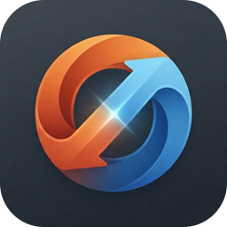
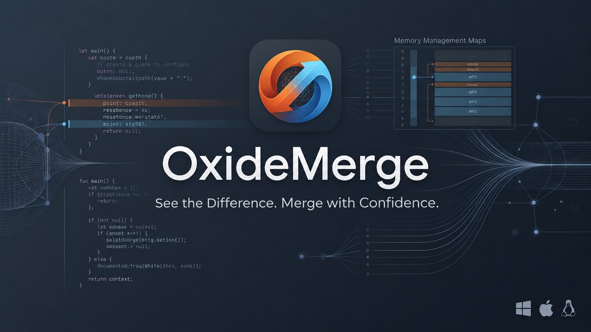
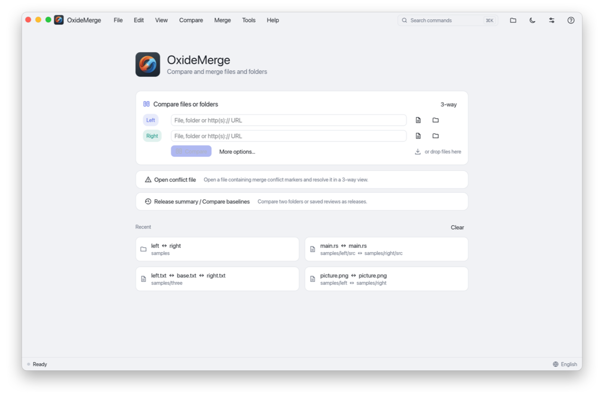
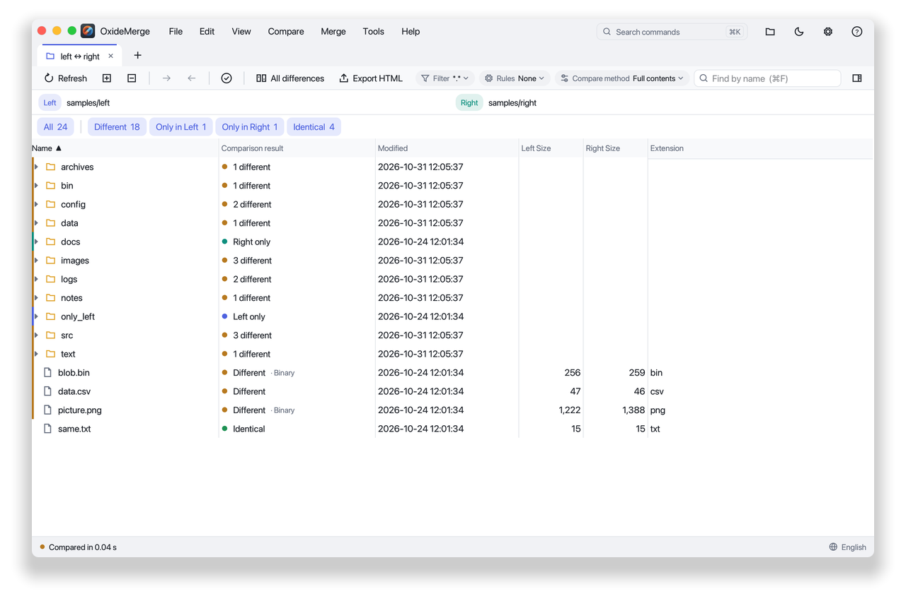
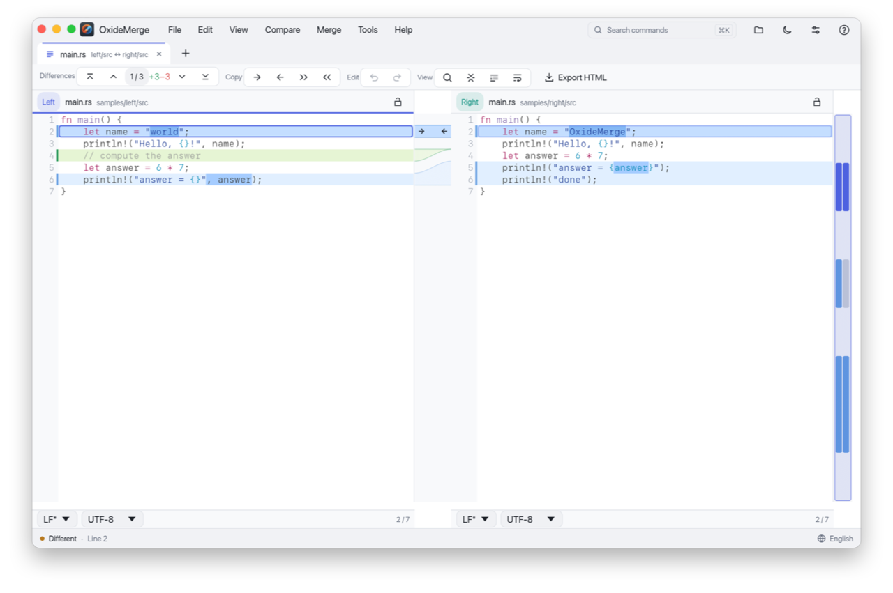
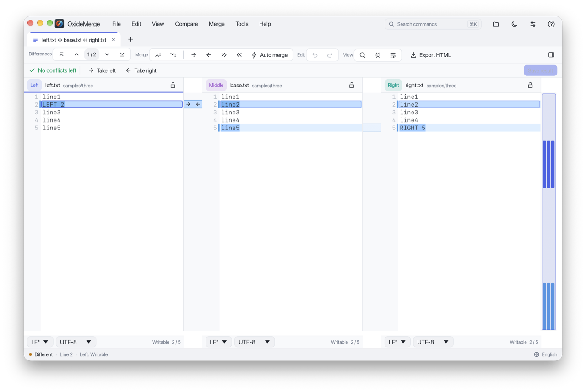
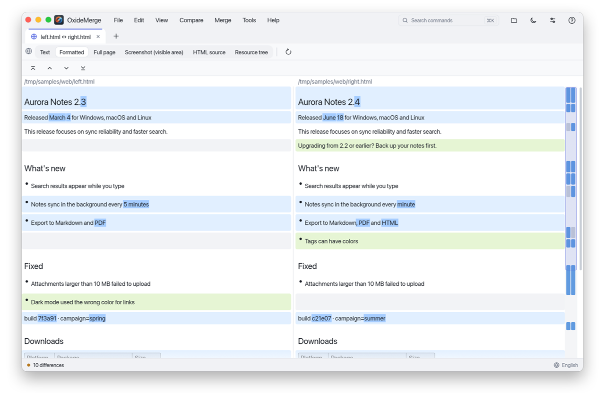

#  OxideMerge

English | [繁體中文](README_zh-TW.md)



OxideMerge is a free and open-source tool that compares and merges files and folders. It
runs on **Windows, macOS and Linux**. Use it to review changes, combine edits and resolve
merge conflicts.

OxideMerge is written in Rust. It compares text, folders, binary files, images and web
pages.

**[Download](https://github.com/kuopinghsu/OxideMerge/releases)** ·
[User guide](docs/user-guide.adoc) ([PDF](docs/dist/oxidemerge-user-guide.pdf)) ·
[Changelog](CHANGELOG.md)



## Contents

- [Features](#features)
- [Screenshots](#screenshots)
- [Installation](#installation)
- [Quick start](#quick-start)
- [Command line](#command-line)
- [Git and file manager integration](#git-and-file-manager-integration)
- [Configuration](#configuration)
- [Documentation and help](#documentation-and-help)
- [Known limitations](#known-limitations)
- [Development](#development)
- [Contributing](#contributing)
- [Security](#security)
- [License](#license)

## Features

### Files and folders

- Compare two files or folders. You can also compare three, with the original version that
  the other two are based on.
- Compare folders with their subfolders, filter items by name, and copy items from one
  folder to the other.
- See all changed text files of a folder comparison in one list with **All differences**.
- **Next difference** and **Previous difference** go through the file shown below the
  folder list and then on to the next changed file. The status bar shows where you are,
  for example *File 2 / 5 · Difference 3 / 7*. In a three-way folder comparison, **Next
  conflict** and **Previous conflict** go on to the next file that both sides changed and
  that still has an open conflict.
- **Synchronize two folders:** preview how one folder would be made to match the other, or
  only brought up to date from it, then apply the changes after you confirm. If applying
  fails or you stop it, the changes made so far are undone.
- Open ZIP, TAR, 7z and other supported archives as folders, including password-protected
  ZIP and 7z archives and ZIP entries compressed with any common method. Edit, copy, merge or
  delete their files and save to write the changes back into the archive, which stays
  encrypted with the same password; a slow-to-compress `.tar.xz` or 7z is written in the
  background.
- Compare a file or folder with a Git, Subversion or Mercurial revision.
- **Compare over SFTP and FTP:** connect to a server over SFTP, FTPS or plain FTP by host,
  port, user, and a password, a private key or `ssh-agent`, and fetch a file or folder to
  compare — open it twice for two remote locations, or once against a local path. Type the
  remote path, or pick it from a list of the server's folders and files. Fetched files and
  folders are writable: *Save* uploads what changed and deletes what was removed, except
  what changed on the server meanwhile, and *Reload from server* fetches again. A new
  server's host key or self-signed certificate fingerprint is shown for you to confirm before
  anything is sent. On the command line and in jobs, a path can be `sftp://`, `ftp://`,
  `ftpes://` or `ftps://`, with the password from `OXIDEMERGE_REMOTE_PASSWORD`. SFTP follows
  `~/.ssh/config` (aliases, keys, `ProxyJump` and `ProxyCommand`), asks the server's sign-in
  questions such as one-time codes, and accepts host certificates from a `@cert-authority`;
  SFTP and FTP can go through a SOCKS5 or HTTP proxy, FTP can use active mode, and FTPS can
  present a client certificate. The connection, including the password or passphrase, is kept only in memory for
  the tab's lifetime.

### Text

- See the changes side by side or in one column. Changed words and moved blocks are
  marked.
- Copy changes from one side to the other, edit the text, and undo or redo your edits.
  Ctrl+click (⌘-click on macOS) adds a text cursor to edit several places at once.
- In a three-way comparison, merge all changes that do not conflict in one step. The merge
  bar shows how many conflicts are left.
- Open a file with conflict markers from Git or another version control system, and
  resolve the conflicts side by side.
- **Compare clipboard:** *File → Compare clipboard* opens a text compare with the clipboard's
  text on the left and a blank, writable right side — paste a second text into it to compare
  the two, with no files needed.
- Ignore white space, comments or lines that match a pattern. Saved comparison rules and
  number tolerances help with generated files and measurement data.
- Use syntax highlighting, search and replace, and bookmarks. CSV and TSV files open in a
  table view that supports records with line breaks, cell editing and cell merging. Rows
  can be matched by key columns instead of by position, columns by their header names, and
  numbers within a tolerance count as equal. Matched rows are listed in left, right or key
  order. Large tables are matched in the background, with progress and **Cancel**, and
  reports record how the rows were matched.
- Add synchronization points to match lines that the comparison paired wrongly.
- Choose one of two row layouts in **View → Text compare** or **Options → General**:
  - **Compact rows** (the default) shows the text without gaps.
  - **Aligned rows** adds blank space opposite inserted and deleted lines, so that
    matching
    lines stay side by side.

### Other file types

- **Binary files:** see the changed bytes in a side-by-side hexadecimal view. Click a byte
  to change it: type hexadecimal digits or text, insert or delete bytes, and save. **Moved
  blocks** highlights matching bytes at different offsets, including blocks shifted by
  insertions or deletions. Select a highlighted byte and use **Go to matching block** to
  jump to its counterpart. Detection refreshes in the background after edits.
- **Images:** compare images side by side, or with the overlay, swipe, blink and
  difference views.
- **Documents, spreadsheets and programs:** PDF, Word (`.docx`), OpenDocument text
  (`.odt`), Rich Text (`.rtf`), Excel (`.xlsx`) and OpenDocument spreadsheets (`.ods`) are
  compared as the text in them, and ELF programs, shared objects and object files as their
  header, program headers, section table and symbols sorted by name — with nothing to
  install. A workbook of one sheet opens as a table comparison, with the columns and key
  matching that offers. These comparisons are read-only: the file itself is never written
  back.
- **Jupyter notebooks (`.ipynb`):** compared cell by cell, each one labeled as a code cell,
  a Markdown cell or a raw cell, with that cell's own source and nothing else; outputs,
  execution counts and other run metadata are left out, so re-running a notebook without
  changing it compares equal.
- **Formatted documents:** choose **Formatted** above the panes to see Word documents,
  Excel workbooks and tagged PDF files as formatted Markdown side by side: headings, bold
  and italic words, lists, links, and tables drawn with their merged cells. Each workbook
  sheet is a table with its dates, amounts and percentages as their formats show them.
  Images are shown with their description and a fingerprint of the picture, so a changed
  picture shows as a change.
- **Web pages:** by default, both pages are converted to Markdown and shown formatted side
  by side, with changed blocks and words highlighted. Other modes show the visible text,
  the HTML source, or the downloaded resources. No mode needs a web browser. Local `.html`
  files also open as web pages.

### Reports and saved work

- Export HTML reports, HTML slideshows with one difference per slide, and XML reports for
  other programs. Export folder summaries as CSV or plain text.
- Export PDF reports and print them, with the fonts embedded so Chinese, Japanese and
  Korean text prints too, and markers that still show in black and white.
- Create patches. Apply unified patches and review the result before you save it.
- Save comparison settings as project files. Save text comparisons with their bookmarks
  and notes. Save portable folder reviews with the file contents, settings, bookmarks and
  comments.
- **Workspaces:** *File → Workspaces → Save as workspace...* saves the open tabs under a name,
  kept in your settings until deleted. *File → Workspaces* then lists every saved workspace to
  reopen all of its tabs at once, alongside whatever is open already.

### Review and analysis

These tools only read files. They run only when you open them.

- **Merge verification:** in a three-way text or folder comparison, expand **Merge
  Verification**. Preview the merge in memory, or check the bytes of the saved result.
- **Semantic comparison:** **Text / Semantic** compares JSON, XML, TOML and YAML files by
  their structure. Changes appear in a tree of paths. Moved array items are marked, and
  you can choose a key that matches array items. Copy a single value to the other side
  without touching the rest of the file, or compare three files and take the left or right
  value for each conflict. A folder option counts files with the same structure as
  identical.
- **Tree view:** **Tree** shows two JSON, YAML, TOML or XML files as one aligned tree,
  with matching nodes on the same row and placeholders where a node exists on one side
  only. Object members and attributes share a row whatever their order or style, an
  inserted array element or XML element is one addition, and a reorder is a move. Changes
  inside folded nodes are counted and never skipped by next/previous difference; the
  selected node's source lines and *Show source* link back to the Text view. Arrays of
  objects are paired by their `id`, `name` or `key` member, and key rules such as
  `servers@name` or `book@id` pair other repeated entries. Search by `$.server.port` or a
  small XPath subset, and *View as collection* lists repeated entries as a table.
- **Review workspace:** in a folder comparison, record a decision for each file and each
  change. Add comments, reasons and tags, and go to the next item that is not reviewed
  yet. Save the review as an `.oxmreview` file to continue on another computer. When the
  files change, earlier decisions are marked as out of date. A changed block is never
  accepted automatically.
- **Release summary:** compare two folders, Git revisions or saved reviews as two
  releases. Moved and renamed files are listed separately from added and deleted files.
- **Potential impact:** find the code that the changes may affect, with the source lines
  as evidence:
  - imports of changed files, and uses of changed functions and types (marked *exact*);
  - places that name a changed path, name or configuration key (marked *heuristic*).

  These results do not prove how the program behaves when it runs. They also do not show
  that a build or its tests pass.

For the rules and limits of each tool, see the [analysis guide](docs/analysis-guide.md).

### Interface and integration

- Light and dark themes, and settings for color-blind friendly colors, high contrast,
  reduced motion and a compact layout.
- Command search: press ⌘K on macOS, or Ctrl+K on Windows and Linux.
- 11 built-in languages: English, Traditional Chinese, Simplified Chinese, Japanese,
  Korean, German, French, Spanish, Russian, Brazilian Portuguese and Italian. You can add
  more with language files.
- Use OxideMerge with Git, from the command line, or from your file manager.

## Screenshots

**Folder comparison**



**Text comparison**



**Three-way merge**



**Web pages in the Formatted mode**



## Installation

Download the package for your system from
[GitHub Releases](https://github.com/kuopinghsu/OxideMerge/releases). Each release also
has PDF user guides in English and Traditional Chinese. The release page lists the SHA-256
checksum of each file, so you can check your download.

| System | Supported versions | Package |
| --- | --- | --- |
| Windows | Windows 10 and 11, on x64 and Arm64 | `windows-x64.zip` or `windows-arm64.zip` |
| macOS | macOS 11 or later, on Apple silicon and Intel | `macos-universal.dmg` |
| Linux | x64 and Arm64, with X11 or Wayland | `.AppImage` or `.tar.gz` |

File names start with the version, for example `oxidemerge-<version>-windows-x64.zip`.

### Windows

Unzip the package and run `oxidemerge.exe`. You do not need an installer.

### macOS

Open the DMG file and drag **OxideMerge** to **Applications**.

The app has an ad hoc signature, and Apple has not notarized it. If macOS blocks the app
the first time, try to open it once. Then go to **System Settings → Privacy & Security**
and click **Open Anyway**. For more information, see
[macOS signing](docs/macos-signing.md).

### Linux

- **AppImage:** runs on Ubuntu 20.04, RHEL 8, Debian 10 and newer. Make the file
  executable with `chmod +x <filename>.AppImage`, then run it. If FUSE is not available,
  start it with `--appimage-extract-and-run`.
- **TAR.GZ:** contains the program, a desktop file and an icon.

File dialogs use `xdg-desktop-portal`. Most desktop environments include it. To show
Chinese, Japanese and Korean text, install a font such as Noto Sans CJK.

## Quick start

When OxideMerge starts, it shows the start page. To start a comparison, do one of these:

- Enter or browse for the files or folders, and click **Compare**.
- Drag the files or folders onto the window.
- Click a recent comparison.

The first time, you can click **Open a sample** to try a small example.

### Compare two files

1. Open the two files. The differences are highlighted side by side.
2. Use the **Compare** menu to go to the next or previous difference.
3. Use the **Merge** menu to copy a change to the other side.
4. Save the file.

### Compare two folders

1. Open the two folders. Turn on subfolders if you need them.
2. Select an item to preview it, or open it in its own comparison tab.
3. Use **All differences** to review all changed text files together.

### Merge three files

Open the files in this order: **your version, the base version, the other version**. The
base version is the original version that the other two are based on. It appears in the
middle pane.

1. Choose **Merge → Auto merge** to merge all changes that do not conflict.
2. The merge bar above the panes shows how many conflicts are left. For each conflict,
   take the left, right or both changes. Or edit the text and mark the conflict as
   resolved.
3. Save the result.

You can also open one file that contains conflict markers.

### Merge three folders

A three-way folder merge writes into the middle folder. **Merge → Auto merge folders...**
first shows the planned copies, deletions and merges. Nothing changes until you confirm.

The merge either completes fully or changes nothing:

- If an item changed after the plan was made, nothing is merged.
- If you stop the merge, or a change fails, all changes made so far are undone.

### Synchronize two folders

In a two-way folder comparison, choose **Synchronize folders...** in the toolbar or the
**Merge** menu. The comparison must include subfolders and must be finished.

1. Choose a mode: **Mirror** makes the destination match the source and deletes what only
   the destination has. **Update** copies new and changed files and deletes nothing.
2. Review the preview. Nothing has changed yet. Each item shows what would happen and why.
   A file that was renamed or moved in the source is also listed under **Rename**. You can
   export the plan as JSON.
3. Choose **Apply changes...** and confirm. Large deletions ask a second time. While the
   changes are applied, the dialog shows the file that is being changed.

Before each change, OxideMerge checks that the file is still the one in the preview, and a
file edited after the preview is not overwritten. Replaced or deleted files are kept in a
recovery journal until the synchronization finishes, so OxideMerge can offer to undo an
interrupted run the next time it starts. See the
[user guide](docs/user-guide.adoc#folder-sync) for the recovery journal and the
free-space check that refuses a plan that would not fit before anything changes.

## Command line

The examples below assume that `oxidemerge` is in your `PATH`. If it is not, use the full
path to the program. On macOS, the program is usually
`/Applications/OxideMerge.app/Contents/MacOS/oxidemerge`.

```sh
# Compare two text files
oxidemerge old.txt new.txt

# Compare two folders and their subfolders
oxidemerge -r old-folder new-folder

# Merge three files and save the middle pane to another file
oxidemerge mine.txt base.txt theirs.txt -o merged.txt

# Open a file with merge conflict markers
oxidemerge conflict.txt

# Export a folder report with text differences, without opening a window
oxidemerge -r old-folder new-folder --report report.html --report-diffs
```

### Common options

| Option | Description |
| --- | --- |
| `-r` | Include subfolders. |
| `-f "*.rs;!target/"` | Filter the folder contents. |
| `-t text`, `-t binary`, `-t image`, `-t web` | Choose the comparison type. |
| `-o <file>` | Save the merge result to another file. |
| `--ignore-case`, `--ignore-eol`, `--ignore-comments` | Ignore letter case, line endings or comments. |
| `--structured` | In folder comparisons, count JSON, XML, TOML and YAML files with the same structure as identical. |
| `--rules <name-or-path>` | Use a comparison rules file. |
| `--rev <revision>` | Compare one file or folder with a Git, Subversion or Mercurial revision (also `--git-rev`). |
| `-L <title>` | Title the next side, as `diff -L` does (Subversion passes these). |
| `--report <file>` | Export a report as `.html`, `.pdf` or `.xml`. Folder comparisons can also use `.csv` or `.txt`. |
| `--report-diffs` | Add text differences to a folder HTML or PDF report. |
| `--page-size a4\|letter`, `--portrait`, `--unified`, `--whole-file` | Lay out a `.pdf` report: page size, portrait pages, one column for two files, or the whole files instead of the differences with `--context` lines. |
| `--slideshow` | Export an HTML slideshow with one difference per slide. |
| `--patch <file>` | Export a patch from a two-way file or folder comparison. |
| `--cli` | Compare without opening a window, for scripts. |

`--cli`, `--report` and `--patch` do not open a window. On Windows, OxideMerge also
accepts the supported WinMerge-style switches, such as `/r`, `/f` and `/o`. Run
`oxidemerge --help` for all options. For the full reference and script examples, see the
[user guide](docs/user-guide.adoc).

### Exit codes for scripts

| Code | Meaning |
| --- | --- |
| `0` | The content is the same. |
| `1` | The content is different. |
| `2` | An error happened. |

### Review and analysis commands

```sh
oxidemerge --merge-plan left.txt base.txt right.txt --report merge-plan.json
oxidemerge --validate-merge merged.txt left.txt base.txt right.txt --report validation.json
oxidemerge --semantic --format json old.json new.json --report semantic.html
oxidemerge --semantic left.yaml base.yaml right.yaml --report conflicts.json
oxidemerge --review-summary review.oxmreview --report review-summary.json
oxidemerge --baseline-left git:v1.0:/path/to/repo --baseline-right git:v1.1:/path/to/repo --release-report release.html
oxidemerge --impact old-folder new-folder --report impact.json
```

These commands write analysis reports as JSON, HTML or XML. The analysis reports have
their own format with a version number. The other reports do not change. These commands
never overwrite an input file, and never write a report inside an input folder.

| Code | Meaning |
| --- | --- |
| `0` | Success, or no differences. |
| `1` | Differences or warnings were found. |
| `2` | An error happened, for example a baseline path cannot be read. |
| `3` | `--validate-merge` found a problem. |

### Folder synchronization commands

```sh
# Plan a mirror of source into destination; nothing is changed
oxidemerge --sync-plan mirror source destination --report plan.json
# Apply the plan after checking every file again
oxidemerge --sync-apply plan.json --yes source destination
# Undo synchronizations that did not finish
oxidemerge --sync-recover
```

`--sync-plan` takes `mirror` or `update`, and `--sync-links` to synchronize symbolic links
as links (macOS and Linux). The plan file holds relative paths only, with the filter and a
fingerprint of the two folder paths, not the paths themselves. `--sync-apply` compares the
folders again and refuses the plan when anything in it has changed, when the filter
differs, or when it was made for other folders. A file touched without changing its
contents still fits the plan.

| Code | Meaning |
| --- | --- |
| `0` | Nothing to do (`--sync-plan`), every change was applied (`--sync-apply`), or everything was undone (`--sync-recover`). |
| `1` | `--sync-plan` found changes or conflicts. |
| `2` | An error happened, or the plan was refused and nothing was changed. |
| `4` | Applying failed or was stopped, and every change was undone. |
| `5` | Partly applied: some changes could not be undone, also by `--sync-recover`. The recovery journals named in the output are kept. |

### Jobs

A job file (`.oxjob`, JSON) lists compares, reports, sync plans and syncs to run in order:

```json
{
  "version": 1,
  "jobs": [
    { "name": "report", "left": "a", "right": "b", "recursive": true, "report": "report.html" },
    { "kind": "sync", "source": "a", "destination": "${env:BACKUP}", "mode": "mirror", "apply": true }
  ]
}
```

```sh
oxidemerge --job nightly.oxjob --yes
```

Each job runs as its command line would. Paths are relative to the job file's folder, and
in paths `${env:NAME}` is the only expansion; nothing is run through a shell. A sync job
needs `"apply": true` in the file and `--yes` on the command line, and so does a report or
patch outside the job file's folder. The run stops at the first job that fails, unless
`"continue_on_error": true`, prints a JSON summary, and exits with the worst code of its
jobs. See the user guide for every field.

In the program, *File → Save as job...* saves a folder comparison as a job, and *File →
Run job...* runs a job file and lists the results; a sync job runs there only after you
allow its changes.

## Git and file manager integration

### Git

OxideMerge can be Git's visual diff and merge tool. Put `oxidemerge` in your `PATH`. Then
run these commands in a POSIX shell, such as Bash or Git Bash:

```sh
git config --global diff.tool oxidemerge
git config --global difftool.oxidemerge.cmd 'oxidemerge "$LOCAL" "$REMOTE"'
git config --global merge.tool oxidemerge
git config --global mergetool.oxidemerge.cmd \
  'oxidemerge "$LOCAL" "$BASE" "$REMOTE" -o "$MERGED" --dl Local --dr Remote --wl --wr'
git config --global mergetool.oxidemerge.trustExitCode false
```

- `git difftool` compares single files. `git difftool --dir-diff` opens a folder
  comparison.
- `git mergetool` resolves conflicts. Review the three versions, merge into the middle
  pane, and save. The result goes to Git's merge output file. The base file does not
  change.

If the program is not in your `PATH`, use its full path in these commands. For more
details, see the [user guide](docs/user-guide.adoc).

### Subversion, Mercurial and Perforce

`svn diff --diff-cmd oxidemerge` works as it is: OxideMerge accepts the `-u` and `-L`
titles that Subversion passes, so the panes show revision names. Mercurial (`extdiff` and
`merge-tools`) and Perforce (`P4DIFF`, `P4MERGE`, or P4V's *Diff* and *Merge* preferences)
are set up in their own configuration. Subversion's `merge-tool-cmd` and Perforce's
`P4MERGE` can be `oxidemerge` itself: the files are reordered, and an unchanged result
exits with code 1 so the conflict stays unresolved. See
[Subversion, Mercurial and Perforce](docs/user-guide.adoc#other-vcs) in the user guide.

### File managers

To add OxideMerge to your file manager, use the **Tools** menu. Or run
`oxidemerge --register-shell` from the installed program. To remove it, run
`oxidemerge --unregister-shell`.

- **Windows Explorer:** compare the selected files or folders from the context menu. On
  Windows 11, the commands are under **Show more options**.
- **macOS Finder:** use the OxideMerge Quick Actions and Services.
- **Linux:** use the menu commands in Nautilus, Nemo or Dolphin.

You can compare the selected items right away. Or mark one item with **Select Left** or
**Select Middle**, and choose the other item later. The commands start the program from
the place where you registered it. If you move the program, register it again.

## Configuration

Use **Options** to change the comparison settings, the appearance and the language.
OxideMerge saves the settings in this file:

| System | Settings file |
| --- | --- |
| Windows | `%APPDATA%\OxideMerge\config.json` |
| macOS | `~/Library/Application Support/OxideMerge/config.json` |
| Linux | `~/.config/OxideMerge/config.json` |

- **Portable use:** create an empty `oxidemerge.json` file next to the program. OxideMerge
  then keeps its settings there.
- **Separate settings:** set the `OXIDEMERGE_CONFIG_DIR` environment variable to another
  folder.

### Filters

File filters choose which items a folder comparison shows:

- Separate patterns with `;`.
- Start a pattern with `!` to exclude matching items.
- End a pattern with `/` or `\` to match folders.

For example, `*.rs;*.toml;!target/` shows Rust and TOML files and hides the `target`
folder. You can also use WinMerge `.flt` files. Put them in the `Filters` folder inside
the settings folder.

### Compare rules

Compare rules choose which differences to ignore. Use **Options → Compare rules** to
manage `.oxrules` files. A rules file can ignore lines, replace text and ignore blocks of
text. You can import and export rules, so that other projects or team members can use
them. Each folder comparison can use its own rules file.

### Languages

The built-in translations are in [lang/](lang). To add or change a translation:

1. Copy `lang/en.json` to `<code>.json`, for example `nl.json`.
2. Set `_name` to the name of the language in that language, for example `Nederlands`. The
   language menu shows this name.
3. Translate the other values. Do not change the `{placeholder}` names.
4. Put the file in a `Languages` folder next to the program or inside the settings folder.

Missing messages, and translations with wrong placeholders, are shown in English.

## Documentation and help

- [User guide](docs/user-guide.adoc): how to compare and merge, comparison options,
  keyboard shortcuts, Git integration and troubleshooting.
- [User guide in Traditional Chinese](docs/user-guide.zh-TW.adoc).
- The user guide as PDF files, for the latest version on `main`:
  [English](docs/dist/oxidemerge-user-guide.pdf) and
  [Traditional Chinese](docs/dist/oxidemerge-user-guide.zh-TW.pdf).
  Each release also has the guides for that version.
- [Analysis guide](docs/analysis-guide.md): merge verification, semantic comparison,
  review workspaces, release summaries and potential impact.
- [Benchmarks](docs/benchmarks.md): performance results and how to measure them.
- [Changelog](CHANGELOG.md): the changes in each version.
- [Development guide](docs/development.md): how to build, test and release OxideMerge.

In the app, press **F1** or click the **?** button to open **Help & Shortcuts**. It lists
the keyboard and mouse actions, and shows where your settings are saved. On macOS, most
shortcuts use Command instead of Ctrl. The app shows the right keys for your system.

## Known limitations

### Files and folders

- Saving an edited archive writes a new archive file in place of the original. A review
  snapshot or a web page tree kept as a folder stays read-only, and so does a signed
  package. RAR files and archives split into parts are not supported.
- Unpacker plugins run external commands. They work the same way in file comparisons,
  folder comparisons of full contents, the command line and reports, and a plugin is
  always used in preference to what OxideMerge reads itself. The presets need conversion
  tools that you install separately.
- Folder synchronization changes files one at a time, so it is not one atomic step. A
  renamed or moved file is moved in the destination, also when only its letter case or the
  way its accents are written changed, but it is copied and deleted when the two places
  are on different drives. Folders renamed only in letter case, and other names that
  differ only in letter case or accents (composed or not), are left alone. So are symbolic
  links, unless *Copy symbolic links as links* (`--sync-links`) is on, which works on
  macOS and Linux only.

### Text

- The text panes are meant for reviewing and merging changes, not as a full editor. You
  can type at the cursor and select across lines, and Alt+drag selects columns, but there
  is no cursor in the inline view.

### Other file types

- JSON and XML files are read-only when automatic formatting is on. Turn it off to edit or
  merge them.
- Web page compare does not run JavaScript, so it can miss content that a page's scripts
  add.
- Pages that need a login are not supported. They may show the login page instead.
- The documents, spreadsheets and programs that OxideMerge reads itself are compared as
  the text it reads from them, not as the files they are: layout, fonts, formulas and
  anything else the format holds are not compared, and the comparison is read-only. A PDF
  records where each glyph goes rather than words, so columns, tables and ligatures may
  not come out as they look. The older Word `.doc` and Excel `.xls` are not read; use a
  plugin for those.
- The **Formatted** view of a PDF needs a tagged PDF, which says which text is a heading,
  paragraph, list or table. Most word processors tag the PDFs they export; a scan or an
  untagged PDF can be compared as text only. Fills, fonts, borders, formulas and charts
  are not compared in the Formatted view either.

### Interface and integration

- WinMerge project files and filter files work. WinMerge plugin DLLs and scripts do not
  work.
- Perforce has no *Compare with revision*. On Windows, Mercurial can only open a file name
  the ANSI code page can spell, which is the same limit `hg` has. A Subversion or Perforce
  server can still ask for a sign-in that OxideMerge cannot give; sign in with `svn` or
  `p4` first. P4V uses its own argument string, so closing it without saving does not by
  itself leave the conflict unresolved.
- The translations were made with machine help. Native speakers have not reviewed them
  yet.

## Development

To build OxideMerge from source, install a Rust toolchain with
[rustup](https://rustup.rs/). Linux also needs a C compiler. Then run these commands in
the repository folder:

```sh
cargo build --release --locked
cargo test --locked
```

The program is `target/release/oxidemerge`, or `target/release/oxidemerge.exe` on Windows.
Run `make demo` to open a sample folder comparison.

For the Make targets, tests, continuous integration and release steps, see the
[development guide](docs/development.md).

## Contributing

Bug reports, feature ideas, documentation fixes and translations are welcome. Open an
issue on [GitHub Issues](https://github.com/kuopinghsu/OxideMerge/issues), or send a pull
request. For code changes, follow the [development guide](docs/development.md) and run the
checks before you send a pull request.

## Security

To report a security problem, see [SECURITY.md](SECURITY.md). It also explains how
OxideMerge handles untrusted files and how the dependencies are checked.

## License

OxideMerge is released under the [MIT License](LICENSE).

Release builds also contain third-party code under its own permissive licenses, listed in
[`deny.toml`](deny.toml): the Rust crates in `Cargo.lock`, and, for SFTP, the C libraries
libssh2 (BSD 3-Clause) and OpenSSL (Apache 2.0), compiled in.
