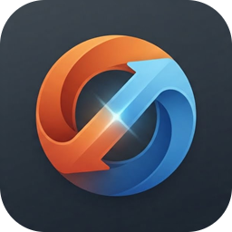
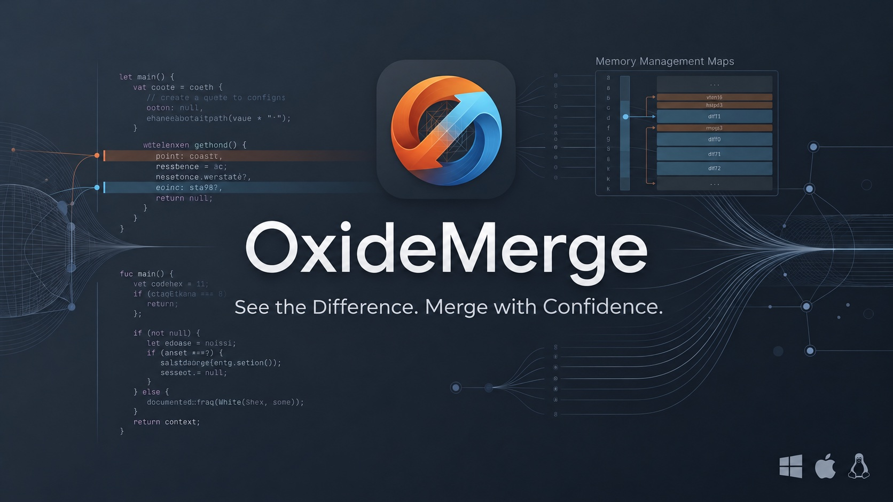
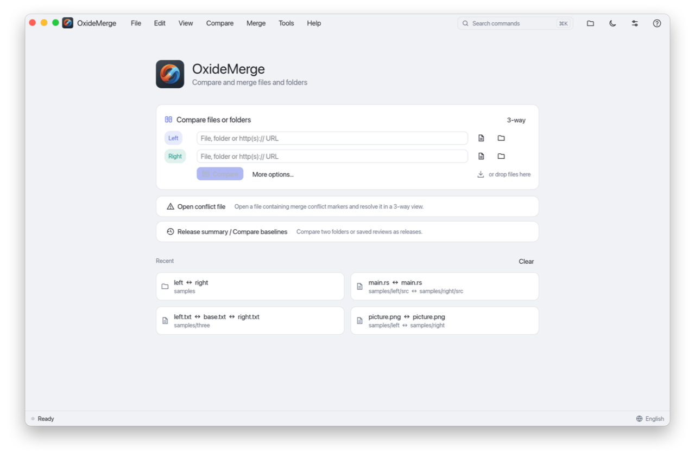
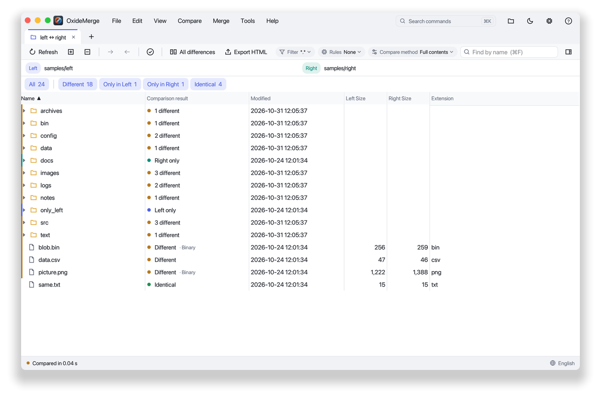
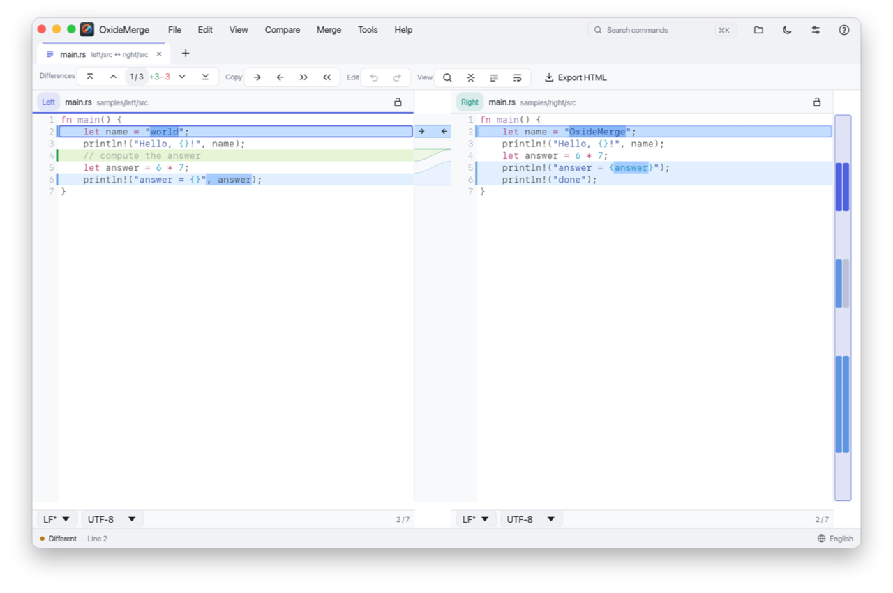
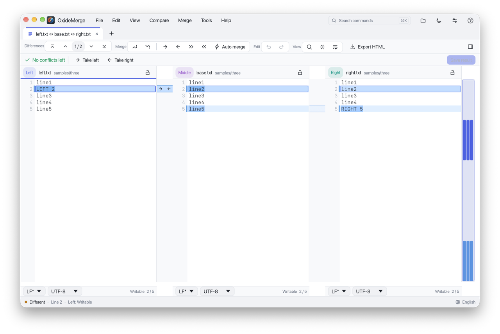
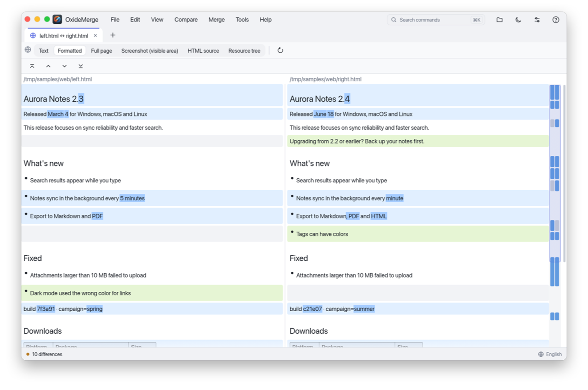

#  OxideMerge

[English](README.md) | 繁體中文



OxideMerge 是免費、開放原始碼的檔案與資料夾比較及合併工具，可在
**Windows、macOS 與 Linux** 上執行。
您可以用它檢視差異、整合修改內容，並解決合併衝突。

OxideMerge 以 Rust 開發，可以比較文字、資料夾、二進位檔、影像與網頁。

**[下載](https://github.com/kuopinghsu/OxideMerge/releases)** ·
[使用者指南](docs/user-guide.zh-TW.adoc) ·
[變更紀錄](CHANGELOG.md)（英文）



## 目錄

- [主要功能](#主要功能)
- [螢幕截圖](#螢幕截圖)
- [安裝](#安裝)
- [快速入門](#快速入門)
- [指令列](#指令列)
- [Git 與檔案管理員整合](#git-與檔案管理員整合)
- [設定](#設定)
- [說明文件與求助](#說明文件與求助)
- [已知限制](#已知限制)
- [開發](#開發)
- [參與貢獻](#參與貢獻)
- [安全性](#安全性)
- [授權條款](#授權條款)

## 主要功能

### 檔案與資料夾

- 比較兩個檔案或資料夾，也可以加入兩者共同的原始版本，進行三方比較。
- 比較資料夾及其子資料夾、依名稱篩選項目，並在兩個資料夾之間複製項目。
- 透過「**所有差異**」，在同一份清單中檢視資料夾比較裡所有變更過的文字檔。
- 「**下一個差異**」與「**上一個差異**」會逐一走過資料夾清單下方顯示的檔案，再接著前往下一
  個有變更的檔案。
  狀態列會顯示目前位置，例如「檔案 2 / 5 · 差異 3 / 7」。在三方資料夾比較中，
  「**下一個衝突**」與「**上一個衝突**」
  會接著前往下一個兩側都有變更、且仍有未解決衝突的檔案。
- **同步兩個資料夾：** 先預覽如何讓一個資料夾與另一個一致，或只以另一個更新它，經您確認後
  才套用變更。
  若套用失敗或您停止套用，已完成的變更會被復原。
- 將 ZIP、TAR、7z 等支援的壓縮檔當作資料夾開啟，可編輯、複製、合併或刪除其中的檔案，
  儲存後會將變更寫回壓縮檔。
- 將檔案或資料夾與 Git、Subversion 或 Mercurial 的修訂版本比較。
- **透過 SFTP 比較：** 輸入伺服器的主機、埠號、使用者，以及密碼或私密金鑰，即可取得檔案或
  資料夾來比較——連線兩次可比較兩個遠端位置，連線一次則可與本機路徑比較。取得的檔案可編
  輯：「儲存」會將它重新上傳，除非伺服器上的檔案在此期間已被修改；取得的資料夾為唯讀。新伺
  服器的主機金鑰指紋會先顯示給您確認，才會送出任何資料。連線資訊（包括密碼或密碼短語）只會保留在
  記憶體中，直到分頁關閉為止。

### 文字

- 以並排或單欄方式檢視差異，並標示變更的字詞與移動過的區塊。
- 將變更從一側複製到另一側、編輯文字，並復原或重做編輯。按住 Ctrl 點按（macOS 按 ⌘ 點按）
  可新增文字游標，同時在多處編輯。
- 在三方比較中，一次合併所有不衝突的變更；合併列會顯示剩餘的衝突數。
- 開啟 Git 或其他版本控制系統產生的衝突標記檔案，並以並排方式解決衝突。
- **比較剪貼簿：** 「**檔案 → 比較剪貼簿**」會開啟一個文字比較，左側是剪貼簿的文字，右側是
  空白且可編輯的窗格——貼上第二份文字即可比較兩者，不需要任何檔案。
- 忽略空白字元、註解或符合特定模式的行。已儲存的比較規則與數值容許誤差，適合用來比較自動產
  生的檔案與量測資料。
- 提供語法醒目提示、尋找與取代及書籤功能。CSV 與 TSV 檔案會以表格檢視開啟，支援含換行的記
  錄、儲存格編輯與儲存格合併。
  列可以依鍵欄配對而非依位置，欄可以依標題名稱配對，相差在容差內的數字視為相等。配對後的列
  可依左側、右側或鍵值順序列出。
  大型表格會在背景配對，顯示進度並可「**取消**」，報告也會記錄列的配對方式。
- 加入同步點，讓比較時配錯的行重新對齊。
- 可在「**檢視 → 文字比較**」或「**選項 → 一般**」選擇兩種排列方式：
  - 「**緊密排列**」（預設）：文字之間不留空白。
  - 「**對齊排列**」：在新增與刪除的行對面留白，讓對應的行保持並排。

### 其他檔案類型

- **二進位檔：** 以並排的十六進位檢視查看變更的位元組。按一下位元組即可修改：
  輸入十六進位數字或文字、插入或刪除位元組，然後儲存。
  **移動區塊**會標示位於不同位移的相同位元組，包括因插入或刪除而移位的區塊。
  選取已標示的位元組後，按**前往相符區塊**即可跳到對應位置。編輯後會在背景重新偵測。
- **影像：** 並排比較影像，或使用疊合、滑動分隔線、閃爍與差異檢視。
- **文件、試算表與程式：** 不需另外安裝任何程式，即可將 PDF、Word（`.docx`）、
  OpenDocument 文件（`.odt`）、RTF（`.rtf`）、Excel（`.xlsx`）與 OpenDocument 試算表
  （`.ods`）
  以其中的文字比較，並將 ELF 程式、共用程式庫與目的檔以標頭、程式標頭、區段表與依名稱排序
  的符號比較。
  只有一個工作表的活頁簿會以表格比較開啟，可使用欄位與索引鍵配對功能。這類比較均為唯讀：絕
  不會寫回原始檔案。
- **Jupyter notebook（`.ipynb`）：** 逐一儲存格比較，每個儲存格標示為程式碼儲存格、
  Markdown 儲存格或原始儲存格，只比較該儲存格本身的內容；執行後的輸出、執行次數等中繼資料
  都不會列入，因此未變更內容而重新執行的 notebook 會視為相同。
- **格式化文件：** 選擇窗格上方的**格式化**，即可將 Word 文件、Excel 活頁簿與加上標籤的
  PDF
  以格式化的 Markdown 並排顯示：標題、粗體與斜體字詞、清單、連結，以及含合併儲存格的表格。
  活頁簿的每個工作表是一個表格，日期、金額與百分比依其格式顯示。
  圖片以其描述與圖片內容的指紋顯示，因此圖片變更也會顯示為差異。
- **網頁：** 預設會將兩個網頁轉換為 Markdown，並排顯示格式化的內容，同時醒目提示變更的區塊
  與字詞。
  其他模式可顯示可見文字、HTML 原始碼或下載的資源。
  所有模式都不需要網頁瀏覽器。本機的 `.html` 檔案也會以網頁方式開啟。

### 報告與儲存成果

- 匯出 HTML 報告、每張投影片顯示一個差異的 HTML 投影片，以及供其他程式讀取的 XML 報告。
  資料夾比較摘要可匯出為 CSV 或純文字。
- 匯出與列印 PDF 報告：內嵌字型，中文、日文與韓文也能正確列印；以黑白列印時，標記仍清楚可
  辨。
- 產生修補檔。套用統一格式的修補檔時，可先檢查結果再儲存。
- 將比較設定儲存為專案檔；將文字比較連同書籤與註記一起儲存；
  或將檔案內容、設定、書籤與註解一起儲存為可攜式資料夾審閱。
- **工作區：** 「**檔案 → 工作區 → 另存為工作區...**」會將目前開啟的分頁以您指定的名稱儲
  存於設定中，直到您刪除為止。「**檔案 → 工作區**」會列出每個已儲存的工作區，選擇後即可一
  次重新開啟其所有分頁，與目前已開啟的分頁並存。

### 審閱與分析

這些工具只會讀取檔案，而且只在您開啟時才會執行。

- **合併驗證：** 在三方文字或資料夾比較中展開「**合併驗證**」，可在記憶體中預覽合併結果，
  或檢查已儲存結果的位元組。
- **語意比較：** 「**文字／語意**」會依結構比較 JSON、XML、TOML 與 YAML 檔案。
  變更以路徑樹狀圖顯示，並標示移動過的陣列項目；您也可以指定用來配對陣列項目的鍵。
  可將單一值複製到另一側而不影響檔案的其餘部分，或比較三個檔案，並為每個衝突採用左側或右側
  的值。
  資料夾選項可將結構相同的檔案視為相同。
- **樹狀檢視：** 「**樹狀**」將兩個 JSON、YAML、TOML 或 XML 檔案顯示為一棵對齊的樹，對應的
  節點位於同一列，只存在於一側的節點以占位列表示。
  物件成員與屬性不論順序或寫法都位於同一列，插入的陣列元素或 XML 元素只算一項新增，重新排
  序則為移動。
  收合節點內的變更會計數，上一個／下一個差異不會略過；選取節點的原始碼與「顯示原始碼」可回
  到文字檢視。
  物件陣列依其 `id`、`name` 或 `key` 成員配對，`servers@name` 或 `book@id` 等索引鍵規則可
  配對其他重複項目。
  可用 `$.server.port` 或 XPath 子集搜尋，「以集合檢視」將重複項目列成表格。
- **審閱工作區：** 在資料夾比較中，為每個檔案與每項變更記錄決定，加上註解、理由與標籤，
  並跳到下一個尚未審閱的項目。將審閱儲存為 `.oxmreview` 檔後，可在其他電腦上繼續。
  檔案有變更時，先前的決定會標示為過期；變更過的區塊絕不會自動接受。
- **版本摘要：** 將兩個資料夾、Git 修訂版本或已儲存的審閱當作兩個版本比較。
  移動與重新命名的檔案，會與新增、刪除的檔案分開列出。
- **潛在影響：** 找出可能受到變更影響的程式碼，並附上原始碼行作為依據：
  - 匯入變更檔案的位置，以及使用已變更函式與型別的位置（標示為「確切」）；
  - 提到已變更路徑、名稱或設定鍵的位置（標示為「啟發式」）。

  這些結果無法證明程式執行時的行為，也不代表建置或測試能夠通過。

各工具的規則與限制，請參閱[分析指南](docs/analysis-guide.md)（英文）。

### 介面與整合

- 提供淺色與深色主題，以及色盲友善配色、高對比、減少動態效果與緊湊版面等設定。
- 命令搜尋：在 macOS 按 ⌘K，在 Windows 與 Linux 按 Ctrl+K。
- 內建 11 種語言：英文、繁體中文、簡體中文、日文、韓文、德文、法文、西班牙文、俄文、巴西葡
  萄牙文與義大利文。
  您也可以透過語言檔加入其他語言。
- 可搭配 Git 使用，也可以從指令列或檔案管理員啟動比較。

## 螢幕截圖

**資料夾比較**



**文字比較**



**三方合併**



**以格式化模式比較網頁**



## 安裝

請從 [GitHub 發行頁面](https://github.com/kuopinghsu/OxideMerge/releases)下載適合您系統的
套件。
每個發行版本也附有英文與繁體中文 PDF 使用者指南。發行頁面會列出每個檔案的 SHA-256 檢查碼，
方便您驗證下載的檔案。

| 作業系統 | 支援版本 | 套件 |
| --- | --- | --- |
| Windows | Windows 10 與 11，x64 與 Arm64 | `windows-x64.zip` 或 `windows-arm64.zip` |
| macOS | macOS 11 以上版本，Apple 晶片與 Intel | `macos-universal.dmg` |
| Linux | x64 與 Arm64，使用 X11 或 Wayland | `.AppImage` 或 `.tar.gz` |

檔名開頭包含版本號，例如 `oxidemerge-<version>-windows-x64.zip`。

### Windows

將套件解壓縮後，執行 `oxidemerge.exe` 即可，不需要安裝程式。

### macOS

開啟 DMG 檔，將 **OxideMerge** 拖移到「**應用程式**」。

本應用程式採用臨時簽署，尚未經過 Apple 公證。若 macOS 在第一次開啟時阻擋本程式，
請先嘗試開啟一次，再到「**系統設定 → 隱私權與安全性**」按一下「**強制打開**」。
詳情請參閱 [macOS 簽署說明](docs/macos-signing.md)（英文）。

### Linux

- **AppImage：** 可在 Ubuntu 20.04、RHEL 8、Debian 10 及更新版本上執行。
  先以 `chmod +x <filename>.AppImage` 將檔案設為可執行，再啟動它。
  若系統無法使用 FUSE，請在啟動時加上 `--appimage-extract-and-run`。
- **TAR.GZ：** 內含程式、桌面項目檔與圖示。

檔案對話框使用 `xdg-desktop-portal`，大多數桌面環境都已內建。
若要顯示中文、日文與韓文，請安裝 Noto Sans CJK 等字型。

## 快速入門

OxideMerge 啟動後會顯示起始頁。您可以用下列任一方式開始比較：

- 輸入或瀏覽要比較的檔案或資料夾，再按一下「**比較**」。
- 將檔案或資料夾拖放到視窗中。
- 按一下最近使用的比較。

第一次使用時，可以按一下「**開啟範例**」試用一個小型範例。

### 比較兩個檔案

1. 開啟兩個檔案，差異會以並排方式醒目提示。
2. 使用「**比較**」選單跳到下一個或上一個差異。
3. 使用「**合併**」選單將變更複製到另一側。
4. 儲存檔案。

### 比較兩個資料夾

1. 開啟兩個資料夾，並視需要啟用子資料夾比較。
2. 選取項目即可預覽，或在獨立的比較分頁中開啟。
3. 使用「**所有差異**」一起檢視所有變更過的文字檔。

### 合併三個檔案

請依下列順序開啟檔案：**您的版本、基準版本、另一方的版本**。
基準版本是另外兩個版本共同的原始版本，會顯示在中間窗格。

1. 選擇「**合併 → 自動合併**」，合併所有不衝突的變更。
2. 窗格上方的合併列會顯示剩餘的衝突數。每個衝突都可以採用左側、右側或兩側的變更，
   也可以手動編輯後標示為已解決。
3. 儲存結果。

您也可以直接開啟一個含有衝突標記的檔案。

### 合併三個資料夾

三方資料夾合併會將結果寫入中間的資料夾。「**合併 → 自動合併資料夾...**」會先列出預計的複
製、
刪除與合併項目，經您確認後才會變更檔案。

合併只有兩種結果：全部完成，或完全不變。

- 若有項目在計畫產生後又被變更，就不會合併任何項目。
- 若您停止合併，或某項變更失敗，已完成的變更會全部復原。

### 同步兩個資料夾

在雙向資料夾比較中，從工具列或「**合併**」選單選擇「**同步資料夾...**」。比較必須包含子資
料夾，並且已經完成。

1. 選擇模式：「**鏡像**」會讓目的地與來源一致，並刪除只有目的地才有的項目；「**更新**」只
   複製新增與變更的檔案，不刪除任何項目。
2. 檢視預覽。此時尚未變更任何檔案。每個項目都會顯示將發生的動作與原因。在來源中重新命名或
   移動過的檔案，
   也會列在「**重新命名**」之下。您可以將計畫匯出為 JSON。
3. 選擇「**套用變更...**」並確認。大量刪除時會再確認一次。套用期間，對話框會顯示正在變更的
   檔案。

每次變更前，OxideMerge 都會確認檔案仍與預覽時相同；預覽後被編輯過的檔案不會被覆寫。
被取代或刪除的檔案會保存在復原日誌，直到同步完成為止，所以 OxideMerge 下次啟動時能提議
復原未完成的變更。復原日誌與可用空間檢查的詳情，請見
[使用者指南](docs/user-guide.zh-TW.adoc#folder-sync)。

## 指令列

以下範例假設 `oxidemerge` 已加入 `PATH` 環境變數。若尚未加入，請改用程式的完整路徑。
macOS 的程式通常位於 `/Applications/OxideMerge.app/Contents/MacOS/oxidemerge`。

```sh
# 比較兩個文字檔
oxidemerge old.txt new.txt

# 比較兩個資料夾及其子資料夾
oxidemerge -r old-folder new-folder

# 合併三個檔案，並將中間窗格儲存到另一個檔案
oxidemerge mine.txt base.txt theirs.txt -o merged.txt

# 開啟含有合併衝突標記的檔案
oxidemerge conflict.txt

# 不開啟視窗，匯出包含文字差異的資料夾報告
oxidemerge -r old-folder new-folder --report report.html --report-diffs
```

### 常用選項

| 選項 | 說明 |
| --- | --- |
| `-r` | 包含子資料夾。 |
| `-f "*.rs;!target/"` | 篩選資料夾內容。 |
| `-t text`、`-t binary`、`-t image`、`-t web` | 指定比較類型。 |
| `-o <file>` | 將合併結果儲存到另一個檔案。 |
| `--ignore-case`、`--ignore-eol`、`--ignore-comments` | 忽略大小寫、換行字元或註解。 |
| `--structured` | 在資料夾比較中，將結構相同的 JSON、XML、TOML 與 YAML 檔案視為相同。 |
| `--rules <name-or-path>` | 使用比較規則檔。 |
| `--rev <revision>` | 將單一檔案或資料夾與 Git、Subversion 或 Mercurial 修訂版本比較（亦可用 `--git-rev`）。 |
| `-L <title>` | 依序為下一側指定標題，與 `diff -L` 相同（Subversion 會傳入）。 |
| `--report <file>` | 匯出 `.html`、`.pdf` 或 `.xml` 報告；資料夾比較也可匯出 `.csv` 或 `.txt`。 |
| `--report-diffs` | 在資料夾的 HTML 或 PDF 報告中加入文字差異。 |
| `--page-size a4\|letter`、`--portrait`、`--unified`、`--whole-file` | 設定 `.pdf` 報告的版面：紙張大小、直式頁面、兩個檔案以單欄顯示，或顯示完整檔案而非只顯示差異與 `--context` 行前後文。 |
| `--slideshow` | 匯出每張投影片顯示一個差異的 HTML 投影片。 |
| `--patch <file>` | 從雙向檔案或資料夾比較產生修補檔。 |
| `--cli` | 不開啟視窗直接比較，適合在指令碼中使用。 |

`--cli`、`--report` 與 `--patch` 都不會開啟視窗。在 Windows 上，也可以使用 `/r`、`/f`、
`/o` 等
支援的 WinMerge 格式參數。執行 `oxidemerge --help` 可查看所有選項。
完整的選項說明與指令碼範例，請參閱[使用者指南](docs/user-guide.zh-TW.adoc)。

### 指令碼使用的結束代碼

| 代碼 | 意義 |
| --- | --- |
| `0` | 內容相同。 |
| `1` | 內容不同。 |
| `2` | 發生錯誤。 |

### 審閱與分析指令

```sh
oxidemerge --merge-plan left.txt base.txt right.txt --report merge-plan.json
oxidemerge --validate-merge merged.txt left.txt base.txt right.txt --report validation.json
oxidemerge --semantic --format json old.json new.json --report semantic.html
oxidemerge --semantic left.yaml base.yaml right.yaml --report conflicts.json
oxidemerge --review-summary review.oxmreview --report review-summary.json
oxidemerge --baseline-left git:v1.0:/path/to/repo --baseline-right git:v1.1:/path/to/repo --release-report release.html
oxidemerge --impact old-folder new-folder --report impact.json
```

這些指令會以 JSON、HTML 或 XML 格式輸出分析報告。分析報告使用獨立且有版本編號的格式，
其他報告的格式不受影響。這些指令絕不會覆寫輸入檔案，也不會將報告寫入輸入資料夾內。

| 代碼 | 意義 |
| --- | --- |
| `0` | 成功，或沒有差異。 |
| `1` | 發現差異或警告。 |
| `2` | 發生錯誤，例如無法讀取基準路徑。 |
| `3` | `--validate-merge` 發現問題。 |

### 資料夾同步指令

```sh
# 規劃將來源鏡像到目的地；不會變更任何檔案
oxidemerge --sync-plan mirror source destination --report plan.json
# 再次檢查每個檔案後套用計畫
oxidemerge --sync-apply plan.json --yes source destination
# 復原未完成的同步
oxidemerge --sync-recover
```

`--sync-plan` 可指定 `mirror` 或 `update`，加上 `--sync-links` 可將符號連結以連結本身同步
（macOS 與 Linux）。
計畫檔只包含相對路徑，另記錄篩選條件與兩個資料夾路徑的指紋，
而不記錄路徑本身。`--sync-apply` 會重新比較資料夾，只要計畫中的任何項目已變更、篩選條件不
同，或計畫是為其他資料夾製作的，
就會拒絕套用。只被更新時間、內容未變的檔案仍符合計畫。

| 代碼 | 意義 |
| --- | --- |
| `0` | 沒有需要做的事（`--sync-plan`）、所有變更都已套用（`--sync-apply`），或已全部復原（`--sync-recover`）。 |
| `1` | `--sync-plan` 發現變更或衝突。 |
| `2` | 發生錯誤，或計畫被拒絕且未變更任何檔案。 |
| `4` | 套用失敗或被停止，所有變更都已復原。 |
| `5` | 部分套用：有些變更無法復原，`--sync-recover` 也無法復原。輸出中列出的復原日誌會保留。 |

### 工作

工作檔（`.oxjob`，JSON 格式）依序列出要執行的比較、報告、同步計畫與同步：

```json
{
  "version": 1,
  "jobs": [
    { "name": "report", "left": "a", "right": "b", "recursive": true, "report": "report.html" },
    { "kind": "sync", "source": "a", "destination": "${env:BACKUP}", "mode": "mirror", "apply": true }
  ]
}
```

```sh
oxidemerge --job nightly.oxjob --yes
```

每個工作的結果與對應的命令列相同。路徑相對於工作檔所在的資料夾，路徑中唯一的展開方式是
`${env:NAME}`；
不會透過命令殼層執行任何指令。同步工作必須在檔案中設定 `"apply": true`，並在命令列加上
`--yes`；
位於工作檔所在資料夾之外的報告或修補檔也需要 `--yes`。
除非設定 `"continue_on_error": true`，否則會在第一個失敗的工作停止；執行後輸出 JSON 摘要，
結束代碼為所有工作中最差的代碼。所有欄位請參閱使用手冊。

在程式中，*檔案 → 另存為工作...* 可將資料夾比較存成工作，*檔案 → 執行工作...* 可執行工作檔
並列出結果；
同步工作要在您允許變更後才會執行。

## Git 與檔案管理員整合

### Git

OxideMerge 可以作為 Git 的圖形化比較與合併工具。請先將 `oxidemerge` 加入 `PATH`，
再於 Bash 或 Git Bash 等相容 POSIX 的命令殼層中執行下列指令：

```sh
git config --global diff.tool oxidemerge
git config --global difftool.oxidemerge.cmd 'oxidemerge "$LOCAL" "$REMOTE"'
git config --global merge.tool oxidemerge
git config --global mergetool.oxidemerge.cmd \
  'oxidemerge "$LOCAL" "$BASE" "$REMOTE" -o "$MERGED" --dl Local --dr Remote --wl --wr'
git config --global mergetool.oxidemerge.trustExitCode false
```

- `git difftool` 可比較個別檔案；`git difftool --dir-diff` 會開啟資料夾比較。
- `git mergetool` 可用來解決衝突。請檢視三個版本，將變更合併到中間窗格，然後儲存。
  結果會寫入 Git 指定的合併輸出檔案，基準檔案不會變更。

若程式不在 `PATH` 中，請在上述指令中使用完整路徑。詳情請參閱
[使用者指南](docs/user-guide.zh-TW.adoc)。

### Subversion、Mercurial 與 Perforce（實驗性）

> 對 Subversion、Mercurial 與 Perforce 的支援屬於實驗性功能，尚未完整測試；
> 詳情請見[已知限制](#已知限制)。

`svn diff --diff-cmd oxidemerge` 可直接使用：OxideMerge 接受 Subversion 傳入的 `-u` 與
`-L` 標題，
因此窗格會顯示修訂版本名稱。
Mercurial（`extdiff` 與 `merge-tools`）與 Perforce
（`P4DIFF`、`P4MERGE`，或 P4V 的 Diff 與 Merge 偏好設定）
需在各自的設定中設定；Subversion 與 p4 命令列的合併要透過一個簡短的包裝指令碼。
請參閱使用者指南中的
[Subversion、Mercurial 與 Perforce](docs/user-guide.zh-TW.adoc#other-vcs)。

### 檔案管理員

若要將 OxideMerge 加入檔案管理員，請使用「**工具**」選單，
或以已安裝的程式執行 `oxidemerge --register-shell`。若要移除，請執行
`oxidemerge --unregister-shell`。

- **Windows 檔案總管：** 從右鍵選單比較選取的檔案或資料夾。Windows 11 的命令位於
  「**顯示其他選項**」中。
- **macOS Finder：** 使用 OxideMerge 的「快速動作」與「服務」。
- **Linux：** 使用 Nautilus、Nemo 或 Dolphin 中的選單命令。

您可以立即比較選取的項目，也可以先用「**選為左側**」或「**選為中間**」標記一個項目，稍後再
選擇另一個項目。
這些命令會從註冊時的位置啟動程式；若搬移了程式，請重新註冊。

## 設定

使用「**選項**」可變更比較設定、外觀與語言。OxideMerge 會將設定儲存在下列檔案：

| 作業系統 | 設定檔 |
| --- | --- |
| Windows | `%APPDATA%\OxideMerge\config.json` |
| macOS | `~/Library/Application Support/OxideMerge/config.json` |
| Linux | `~/.config/OxideMerge/config.json` |

- **可攜式使用：** 在程式所在的資料夾中建立空白的 `oxidemerge.json` 檔案，設定就會儲存在該
  處。
- **獨立設定：** 將 `OXIDEMERGE_CONFIG_DIR` 環境變數設為另一個資料夾。

### 篩選器

檔案篩選器決定資料夾比較要顯示哪些項目：

- 以 `;` 分隔多個條件。
- 在條件前加上 `!`，可排除符合的項目。
- 在條件結尾加上 `/` 或 `\`，表示比對資料夾。

例如 `*.rs;*.toml;!target/` 會顯示 Rust 與 TOML 檔案，並隱藏 `target` 資料夾。
您也可以使用 WinMerge 的 `.flt` 檔案，請將它們放在設定資料夾內的 `Filters` 資料夾中。

### 比較規則

比較規則決定要忽略哪些差異。請透過「**選項 → 比較規則**」管理 `.oxrules` 檔案。
規則檔可以忽略特定行、取代文字，以及忽略整個文字區塊。規則可以匯入與匯出，
方便其他專案或團隊成員使用。每個資料夾比較都可以使用自己的規則檔。

### 語言

內建翻譯位於 [lang/](lang)。若要新增或修改翻譯：

1. 將 `lang/en.json` 複製為 `<code>.json`，例如 `nl.json`。
2. 將 `_name` 設為該語言本身的名稱，例如 `Nederlands`。語言選單會顯示這個名稱。
3. 翻譯其他的值，但不要變更 `{placeholder}` 名稱。
4. 將檔案放在程式旁邊或設定資料夾內的 `Languages` 資料夾中。

缺少的訊息，以及預留位置有誤的翻譯，會以英文顯示。

## 說明文件與求助

- [使用者指南](docs/user-guide.zh-TW.adoc)：比較與合併的操作方式、比較選項、快速鍵、Git 整
  合與疑難排解。
- [英文使用者指南](docs/user-guide.adoc)。
- [分析指南](docs/analysis-guide.md)：合併驗證、語意比較、審閱工作區、版本摘要與潛在影響
  （英文）。
- [效能測試](docs/benchmarks.md)：效能量測結果與量測方式（英文）。
- [變更紀錄](CHANGELOG.md)：各版本的變更內容（英文）。
- [開發指南](docs/development.zh-TW.md)：如何建置、測試與發布 OxideMerge。

在程式中按 **F1** 或按一下 **?** 按鈕，即可開啟「**說明與快速鍵**」。其中列出鍵盤與滑鼠操
作，
並顯示設定檔的儲存位置。在 macOS 上，多數快速鍵以 Command 鍵取代 Ctrl 鍵；
程式會依您的作業系統顯示正確的按鍵。

## 已知限制

### 檔案與資料夾

- 儲存編輯過的壓縮檔時，會以新的壓縮檔取代原始檔案。以檢閱快照或網頁的頁面樹狀結構
  開啟並當作資料夾的內容仍為唯讀。不支援 RAR 檔案。
- 解譯器外掛程式會執行外部命令，在檔案比較、完整內容的資料夾比較、指令列與報告中的行為都相
  同，
  且一律優先於 OxideMerge 自行讀取的方式。
  PDF 與 Office 預設組態需要另行安裝轉換工具。
- 資料夾同步會逐一變更檔案，因此不是單一的不可分割操作。重新命名或移動過的檔案會在目的地中
  移動，
  只改變大小寫或重音寫法的也一樣；但若新舊位置位於不同磁碟，則會先複製再刪除。
  只改變大小寫的資料夾，以及其他只有大小寫或拉丁字母重音寫法（組合或分解）不同的名稱，都不
  會被變更。
  符號連結也一樣，除非開啟 *將符號連結以連結本身複製*（`--sync-links`）；此功能僅適用於
  macOS 與 Linux。

### 文字

- 文字窗格主要用於檢視與合併變更，並非完整的編輯器。可以在游標處輸入、跨行選取，並以 Alt+
  拖曳選取欄，但內嵌檢視中沒有游標。

### 其他檔案類型

- 啟用自動格式化時，JSON 與 XML 檔案為唯讀。若要編輯或合併，請關閉此功能。
- 網頁比較不會執行 JavaScript，因此可能缺少網頁指令碼加入的內容。
- 不支援需要登入的網頁，這類網頁可能只會顯示登入畫面。
- OxideMerge 自行讀取的文件、試算表與程式，是以讀取到的文字比較，而非以檔案本身比較：
  版面、字型、公式等格式中的其他內容並不會被比較，且比較為唯讀。
  PDF 記錄的是各字形的位置而非詞語，因此分欄、表格與連字可能無法完全還原。
- PDF 的**格式化**檢視需要加上標籤的 PDF，標籤註明哪些文字是標題、段落、清單或表格。
  多數文書處理程式匯出的 PDF 都有標籤；掃描檔或沒有標籤的 PDF 只能以文字比較。
  格式化檢視同樣不比較填色、字型、框線、公式與圖表。
  舊版 Word `.doc` 與 Excel `.xls` 尚未支援，請改用外掛程式。

### 介面與整合

- 支援 WinMerge 專案檔與篩選器檔案，但不支援 WinMerge 的外掛程式動態連結程式庫與指令碼。
- 對 Subversion、Mercurial 與 Perforce 的支援（比較與合併設定，以及 Subversion 與
  Mercurial 的「與修訂版本比較」；
  Perforce 沒有「與修訂版本比較」）屬於實驗性功能，尚未完整測試：
  僅在 macOS 上以本機儲存庫與本機 Perforce 伺服器試過。Windows、Linux，以及透過網路連線的
  Subversion 與 Perforce 伺服器皆尚未試過。
- 各語言翻譯由機器輔助完成，尚未經母語人士審閱。

## 開發

若要從原始碼建置 OxideMerge，請先透過 [rustup](https://rustup.rs/) 安裝 Rust 工具鏈。
Linux 另需要 C 編譯器。接著在儲存庫資料夾中執行：

```sh
cargo build --release --locked
cargo test --locked
```

建置完成的程式位於 `target/release/oxidemerge`，Windows 則為
`target/release/oxidemerge.exe`。
執行 `make demo` 可開啟範例資料夾比較。

建置指令、測試、持續整合與發布步驟，請參閱[開發指南](docs/development.zh-TW.md)。

## 參與貢獻

歡迎回報問題、提出功能建議、改善文件或協助翻譯。
您可以在 [GitHub 問題回報頁面](https://github.com/kuopinghsu/OxideMerge/issues)提出問題，
或送出合併請求。
修改程式碼時，請依照[開發指南](docs/development.zh-TW.md)操作，並在送出合併請求前執行相關
檢查。

## 安全性

若要回報安全性問題，請參閱 [SECURITY.md](SECURITY.md)（英文）。
該文件也說明 OxideMerge 如何處理不受信任的檔案，以及如何檢查相依套件。

## 授權條款

OxideMerge 採用 [MIT 授權條款](LICENSE)發布。

發行版本也包含採用各自寬鬆授權條款的第三方程式碼，列於 [`deny.toml`](deny.toml)：`Cargo.lock` 中的
Rust crate，以及為 SFTP 編譯進來的 C 函式庫 libssh2（BSD 3-Clause）與 OpenSSL（Apache 2.0）。
